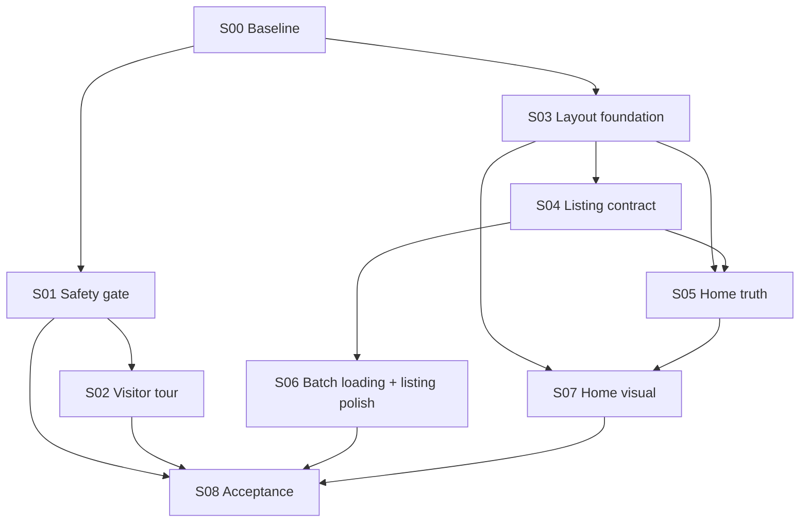

# 01 — Vertical Slice Plan

> Index: [README](README.md) · Evidence: [00-audit](00-audit.md) · Slice index: [02](02-slice-details.md) · Verification: [03](03-verification-matrix.md) · Open questions: [04](04-open-questions.md)
> Baseline SHA: `f9bc00851afadaf2934188cda27061da005b96e8` on `dev/development`.

## 1. Principles
1. Repository is authoritative; every slice re-verifies its own preconditions.
2. No new UI framework, no replacement of Redux or `api`/`restaurantApi`; extend existing slices/abstractions.
3. No invented endpoints/fields/metrics. Where data is absent, use the **honest fallback** written into the slice (remove, rename, truthfully label client-side, or mark BLOCKED).
4. Each slice ships and verifies on its own (own tests, own manual check, own rollback).
5. Security first: S01 precedes anything that invites visitors.

## 2. Ordered slices

| # | ID | Title | User-visible outcome | Depends on | Size | Backend? | Verification target |
|---|---|---|---|---|---|---|---|
| 0 | [SLICE-00](slices/SLICE-00.md) | Baseline capture & safety net | Nothing changes for users; evidence + characterization tests exist | — | S | no | unit, build, runtime (screenshots) |
| 1 | [SLICE-01](slices/SLICE-01.md) | Production safety gate | No dev chips/switcher/overrides in prod; no self-assigned roles; no credential logs | S00 | M | **yes (required)** | unit, integration (API), build, runtime |
| 2 | [SLICE-02](slices/SLICE-02.md) | Visitor showcase & guided tour | A visitor sees an honest "Explore FoodHub" entry and a guided tour with real public deep links | S01 | M | no (decision U/B-04) | component, build, runtime |
| 3 | [SLICE-03](slices/SLICE-03.md) | Layout foundation: Grid v7, uniform restaurant card, SafeImage | Restaurant cards form a true responsive grid with identical geometry and graceful image fallback | S00 | M | no | unit, component, build, runtime |
| 4 | [SLICE-04](slices/SLICE-04.md) | Listing contract: URL ↔ Redux ↔ filters/search | Home CTAs land on a correctly filtered listing; URLs are shareable; search/filter/pagination correct | S03 | L | no | unit, component, integration, runtime |
| 5 | [SLICE-05](slices/SLICE-05.md) | Home truthfulness: data provenance & CTAs | Every Home number/offer/dish/review is real or removed; every CTA does something real | S03, S04 | L | no (B-01/B-02 fallbacks) | unit, component, runtime |
| 6 | [SLICE-06](slices/SLICE-06.md) | Batch loading & listing polish | "Show more" batches, truthful counts, polished loading/empty/error states | S04 | M | optional (B-03) | unit, component, runtime |
| 7 | [SLICE-07](slices/SLICE-07.md) | Home visual redesign & responsive polish | Lively, consistent, responsive Home on real imagery and data | S03, S05 | L | no | component, build, runtime |
| 8 | [SLICE-08](slices/SLICE-08.md) | Regression & portfolio acceptance | Full visitor journey, responsiveness, security boundaries verified and documented | S01-S07 | M | no | E2E/runtime, build |

### Dependency graph

S02 and S03 may run in parallel after their predecessors; S01 must land before S02 is deployed.

### Why this order (and what was merged)
- **Visitor entry before data work** (per brief), but gated on **S01** because the audit found a role-escalation path (S-01) and dev UI leakage.
- **S03 before S04/S05**: the audited Grid bug (D-01) distorts every page; fixing contracts on a layout that cannot be judged is wasteful, and S03 supplies the card S04–S07 reuse.
- **Merged**: card consistency + SafeImage + Grid (shared files: `RestaurantCard_V`, `SafeImage`, `Restaurants_V` grid); URL↔Redux↔filters + search correctness (one navigation/state contract); Home provenance + popular dishes + quick commerce + testimonials (all "truthful Home content"); batch loading + listing polish (both own the listing results pane).
- **S06 follows S04** because "batch loading" must sit on the final filter/sort contract.

## 3. Intended visual direction (applies to S03, S06, S07)
Modern food discovery: **real food photography first** (project assets/restaurant images, never stock or fabricated), restrained palette from the existing theme (coral `primary.main`; drop the off-brand purple gradient), **one card geometry** (16:9 image, fixed-height body, ≤2 cuisine chips, one meta row, optional badge) across Home/listing/search, clear single primary CTA per section, motion limited to: on-scroll fade/translate (≤12 px, once), card hover lift (≤4 px), image fade-in; respect `prefers-reduced-motion`. Section rhythm: one consistent vertical spacing token (e.g. `py: {xs:5, md:8}`), one shared `SectionHeader`, max ~6 sections.
Not prescribed: a full rewrite. Reuse existing components; delete only what S05 proves untruthful.

### Responsive acceptance criteria (shared)
| Viewport | Layout | Cards | Hero | Text/CTA |
|---|---|---|---|---|
| Mobile 360-599 | 1 column, 16 px gutters | full-width, identical height per row, image 16:9 cover | search + one CTA stacked, no horizontal scroll | titles ≤2 lines (ellipsis), CTAs ≥44 px tap target, filters in drawer |
| Tablet 600-899 | 2 columns | equal widths | hero text + search, image hidden or below | no overlap of rating/name |
| Desktop ≥900 | 3 columns (listing with 350 px sidebar may use 2-3) | equal widths, rows align | text left, imagery right | max content width `lg`, CTAs visible without scrolling |
Zero horizontal overflow at 320/360/768/1024/1440 px; no layout shift when images load (aspect-ratio reserved); skeletons share card geometry.

## 4. Honest de-scoping decisions (pre-made, overridable via [04](04-open-questions.md))
| Capability | Confirmed state | Plan |
|---|---|---|
| Popular dishes / "most ordered" | No popularity endpoint; API menu `isBestSeller` always false | Remove "Most ordered/Trending" wording & badges. Default: replace with **"Menu highlights"** built from real menu items of top featured restaurants via existing `GET /restaurants/:id` (≤3 requests, labelled by restaurant, real add-to-cart or deep-link). If rejected: hide the section. |
| Quick commerce | No category/ETA-guarantee data | Remove. Optional truthful shelves from real fields: **"Fastest delivery"** (min `deliveryTime`), **"Free delivery"** (`deliveryFee===0`) — labelled with real values. |
| Testimonials | No aggregate review endpoint; only per-restaurant | Remove from Home. Optional (BLOCKED on backend): "Recent reviews" via a new endpoint — **not planned here**. |
| Promos | No promo endpoint; cart has demo-only codes | Remove, or relabel "Demo codes" only if the cart really applies them (S05 acceptance decides). |
| Stats | Only restaurant count is real | Show real count (+ real cuisine count) only. |
| Server pagination/filtering | Only `page/limit/cuisine/search/city` | Client-side incremental rendering of the ≤200 fetched list (truthfully labelled); server paging only if S06's optional backend work is approved. |
| Role demo access | No guest/demo accounts; sign-up can mint any role (S-01) | Default: customer path via real sign-up + static/recorded tour of owner/partner/admin. Live role accounts only per decision in [04](04-open-questions.md) Q1. |

## 5. Cross-cutting rules for all slices
- Branch: work on `dev/development` (or a feature branch the user approves); one slice → one reviewable change set.
- Before editing run: `git status`, `git rev-parse HEAD` and compare to the baseline SHA; record drift in the slice PR notes.
- Commands (from `web/`): `npm test` (= `vitest run`), `npx vite build --outDir <tmp> --emptyOutDir`, `npx tsc -p tsconfig.app.json --noEmit` (baseline **1,244** errors; a slice must **not increase** the count and should reduce errors in files it touches — compare with `scratch/tsc-app.log` style diff).
- Baseline unit result to preserve: 33 passed, 5 failed, 3 suites unresolved — unrelated pre-existing failures; do not "fix" them inside these slices.
- Never expose `/dev`, dev switchers, or mock simulator toggles in production; never weaken `ProtectedRoute`/`authorize`.
